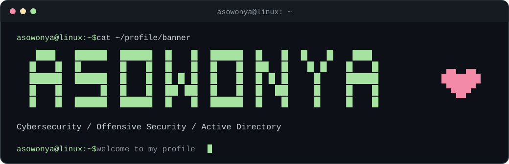

<div align="center">



[](https://ine.com/security/certifications/ejpt-certification)
[](https://www.offsec.com/courses/pen-200/)
[](https://www.alteredsecurity.com/adlab)

</div>

---

### `asowonya@linux:~$ whoami`

```text
       .--.         asowonya@linux
      |o_o |        --------------
      |:_/ |        Focus : Cybersecurity
     //   \ \       Areas : Offensive Security / Active Directory
    (|     | )      Certs : eJPT / OSCP / CRTP
   /'\_   _/`\
   \___)=(___/
```

I'm **Asowonya**, focused on cybersecurity and offensive security. I hold the **eJPT**, **OSCP**, and **CRTP** certifications.

### `asowonya@linux:~$ cat ~/certifications.conf`

```ini
[eJPT]
name   = Junior Penetration Tester
issuer = INE

[OSCP]
name   = OffSec Certified Professional
issuer = OffSec

[CRTP]
name   = Certified Red Team Professional
issuer = Altered Security
```

### `asowonya@linux:~$ exit`

```text
Stay curious. Keep learning.
logout
```

<!-- Optional: replace the certification links with your public verification links. -->
